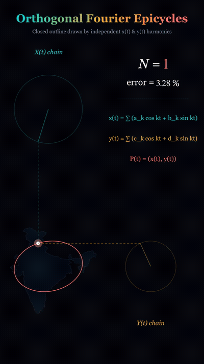

# Orthogonal Fourier Epicycles: World Atlas Edition 🌍

An interactive, production-grade geospatial and mathematical visualization system that reconstructs and animates the closed boundary of **any country in the world** (plus 7 continents and the entire world landmass) using **two independent real Fourier series**, $x(t)$ and $y(t)$. Each axis is animated as its own chain of rotating circles (epicycles) whose orthogonal dashed projection lines intersect with mathematical precision at the moving drawing point $\mathbf{P}(t)$.

<p align="center">
  
  <br>
  <em>Dual independent real Fourier epicycles: X chain (cyan, top-left) and Y chain (gold, bottom-right) meeting perpendicularly at P(t) to trace the boundary.</em>
</p>

---

## 1. Mathematical Concept & Formulation

Unlike the standard single complex-Fourier chain where $z(t) = x(t) + i y(t)$, this project implements **Orthogonal Fourier Decomposition**:

### Real Fourier Series
Any closed, rectifiable planar curve $\mathbf{P}(t) = (x(t), y(t))$ parameterized by normalized arc-length $t \in [0, 2\pi)$ can be decoupled into two independent Cartesian Fourier series:

$$x(t) = a_0 + \sum_{k=1}^N \left( a_k \cos kt + b_k \sin kt \right)$$

$$y(t) = c_0 + \sum_{k=1}^N \left( c_k \cos kt + d_k \sin kt \right)$$

### Harmonic Coefficient Extraction
From $M$ uniform arc-length sample points, the coefficients are computed using the Discrete Fourier Transform (`np.fft.rfft`):

$$X_k = \sum_{m=0}^{M-1} x_m e^{-i \frac{2\pi k m}{M}}, \quad k \in \{0, 1, \dots, \lfloor M/2 \rfloor\}$$

$$a_0 = \frac{1}{M}\text{Re}(X_0), \quad a_k = \frac{2}{M}\text{Re}(X_k), \quad b_k = -\frac{2}{M}\text{Im}(X_k)$$

$$\text{Analogously for } y(t): \quad c_0 = \frac{1}{M}\text{Re}(Y_0), \quad c_k = \frac{2}{M}\text{Re}(Y_k), \quad d_k = -\frac{2}{M}\text{Im}(Y_k)$$

### Polar Epicycle Form
Using trigonometric identities, each harmonic becomes a rotating circle:

$$a_k \cos kt + b_k \sin kt = R_{x,k} \cos(kt - \phi_{x,k})$$

$$\text{where } R_{x,k} = \sqrt{a_k^2 + b_k^2}, \quad \phi_{x,k} = \text{atan2}(b_k, a_k)$$

$$c_k \cos kt + d_k \sin kt = R_{y,k} \cos(kt - \psi_{y,k})$$

$$\text{where } R_{y,k} = \sqrt{c_k^2 + d_k^2}, \quad \psi_{y,k} = \text{atan2}(d_k, c_k)$$

### Dual Chain Orthogonal Geometry
1. **$X(t)$ Chain (Top-Left)**:
   - Root located at $(x_{\text{root}}, y_{\text{root}}) = (x_{\text{center}} + s \cdot a_0, \; Y_{\text{top}})$.
   - Harmonics stacked tip-to-tail; only the **horizontal** component of the final tip determines $x(t)$.
   - A vertical dashed guide line drops from the tip to $\mathbf{P}(t)$.
2. **$Y(t)$ Chain (Bottom-Right)**:
   - Root located at $(X_{\text{right}}, \; y_{\text{center}} + s \cdot c_0)$.
   - Harmonics stacked tip-to-tail; only the **vertical** component of the final tip determines $y(t)$.
   - A horizontal dashed guide line extends left from the tip to $\mathbf{P}(t)$.
3. **Perpendicular Intersection**:
   - The vertical and horizontal dashed projection lines meet perpendicularly at $\mathbf{P}(t) = (x(t), y(t))$ on the canvas.

---

## 2. World Atlas Dataset & Precomputed Pipeline

The atlas pipeline parses **Natural Earth** cartographic data (Admin 0 1:50m Countries & Physical Land, Public Domain):

- **250 Precomputed Regions**:
  - 242 sovereign countries and territories.
  - 7 Continents (Africa, Antarctica, Asia, Europe, North America, Oceania, South America).
  - World (All Land).
- **Projections**:
  - Local equirectangular scaled by $\cos(\phi_0)$ (or Lambert Azimuthal Equal-Area) for individual countries to eliminate high-latitude distortion.
  - Equal Earth and Robinson projections for the World and continental maps.
- **Antimeridian Unwrapping**:
  - Continuous unwrapping of longitudes across the $\pm 180^\circ$ antimeridian prevents horizontal slice artifacts for Russia (Chukotka), Fiji, and the USA (Aleutian Islands).
- **Multi-Part Islands & Unified Bounding Boxes**:
  - Archipelagos (Indonesia, Japan, Philippines, Greece, Canada, UK) are decomposed into ordered rings sorted by area ratio.
  - All rings share a global coordinate offset and scale, ensuring geographical fidelity and relative size.
- **Cartographic Accuracy**:
  - All 250 maps achieve $< 0.5\%$ mean distance error at maximum $N$ (verified by `scripts/validate_atlas.py`, with maximum observed error of $0.025\%$).
- **Disputed Boundaries**:
  - Default: Natural Earth de facto administrative lines.
  - India: Official sovereign boundary as published by the Survey of India / Government of India (documented in `data/README.md`).

---

## 3. Directory Structure

```text
fourier-epicycles/
├── .github/workflows/
│   └── ci.yml                     # Automated testing & GitHub Pages deployment
├── data/
│   ├── raw/                       # Natural Earth 1:50m GeoJSON datasets
│   ├── india_outline.geojson      # Official Survey of India polygon
│   ├── india_mask.png             # Raster silhouette mask
│   └── README.md                  # Dataset provenance, citations, and licenses
├── scripts/
│   ├── fetch_data.py              # Downloads & caches Natural Earth GeoJSONs
│   ├── build_atlas.py             # Compiles all 250 countries & regions
│   ├── validate_atlas.py          # Verifies < 0.5% error across all atlas maps
│   └── make_notebook.py           # Generates world atlas analysis notebook
├── src/
│   ├── config.py                  # Global color palettes, styling, and constants
│   ├── geometry.py                # Polygon extraction, unwrapping, & normalization
│   ├── projections.py             # Equirectangular, Equal Earth, Lambert projections
│   ├── outline.py                 # India contour extraction and arc-length resampling
│   ├── fourier.py                 # FFT decomposition, Lanczos sigma, and cKDTree metrics
│   ├── scene.py                   # Vertical 9:16 India showcase Manim animation
│   └── atlas_scene.py             # General Manim scene for any atlas country
├── web/
│   ├── public/atlas/              # Lazy-loaded atlas JSON files
│   │   ├── index.json             # Country metadata index (< 60 KB)
│   │   ├── world.json             # Global landmass decomposition
│   │   ├── continents/            # 7 continent JSONs
│   │   └── maps/                  # 242 individual country JSONs (<ISO_A3>.json)
│   ├── src/
│   │   ├── types.ts               # Complete TypeScript schemas
│   │   ├── fourier-worker.ts      # Vectorized chain math & canvas Y-inversion
│   │   ├── canvas-renderer.ts     # 60 FPS HTML5 Canvas dual-chain renderer
│   │   ├── math-hud.ts            # Dynamic KaTeX mathematical equation updater
│   │   ├── leaderboard.ts         # Shape complexity modal & difficulty ranking
│   │   ├── export-utils.ts        # PNG, WebM recording, JSON & CSV exporters
│   │   ├── style.css              # Dark & light theme responsive styling
│   │   └── main.ts                # Application controller, keyboard events, URL sync
│   └── index.html                 # Main web application entry point
├── notebooks/
│   ├── error_analysis.ipynb       # Single-country India error analysis
│   └── world_atlas_analysis.ipynb # 10 countries + World log-log decay & fractals
├── output/
│   ├── demo_preview.gif           # Animated demonstration preview
│   ├── preview_frame.png          # High-resolution rendered preview
│   ├── atlas_error_decay_loglog.png # 10-country log-log error comparison
│   ├── shape_complexity_leaderboard.csv # Curated shape difficulty table
│   └── videos/                    # Rendered Manim animation MP4s
├── tests/
│   ├── test_fourier.py            # FFT vs numerical integral, continuity, tips
│   ├── test_geometry.py           # Unwrapping, area, multi-ring normalization
│   └── test_atlas.py              # Atlas schema and error bounds validation
├── render.py                      # Multi-country Manim CLI renderer
├── make_all.py                    # Master end-to-end execution pipeline
├── package.json                   # Web dependencies (Vite, TypeScript, KaTeX)
├── requirements.txt               # Python dependencies (Manim, NumPy, Shapely)
└── README.md
```

---

## 4. Quickstart & Usage

### 1. Prerequisites
- **Python**: 3.10+
- **Node.js**: 18+ (for Web App)
- **FFmpeg**: Required for Manim animation rendering (automatically symlinked via `imageio-ffmpeg`).

### 2. Python Environment Setup
```bash
# Clone the repository
git clone https://github.com/sathvikkasanagpttu/orthogonal-fourier-epicycles.git
cd orthogonal-fourier-epicycles

# Create and activate virtual environment
python3 -m venv .venv
source .venv/bin/activate

# Install dependencies
pip install -r requirements.txt
```

### 3. Launch Interactive Web App
```bash
# Install node packages
npm install

# Start local development server
npm run dev
```
Open [http://localhost:3000](http://localhost:3000) in your browser.

#### Web App Features:
- **Country Search & Autocomplete**: Filter ~240 countries and continents with instant lookup.
- **Continent Chips**: Quick filters for Asia, Europe, Africa, Americas, Oceania, Continents, and World.
- **Live KaTeX HUD**: Real-time equations for $x(t)$, $y(t)$, and $\mathbf{P}(t)$, active harmonic count $N$, and calculated cartographic error %.
- **Controls Toolbar**:
  - Harmonics slider ($N = 1$ to $500$) with `+10` / `-10` step buttons.
  - Playback speed slider ($0.1\times$ to $4.0\times$).
  - Multi-part detail level: "All rings", "Main + large islands", or "Main landmass only".
  - Toggles: Epicycles, Dashed Projection Lines, Lanczos Smoothing (Gibbs suppression), Silhouette Fill, Ground Truth Overlay, Auto N-Sweep.
  - Exports: Canvas PNG screenshot, WebM video recorder (1 full cycle), JSON coefficients, and CSV harmonics table.
  - Shape Complexity Leaderboard modal.
  - Dark / Light theme toggle (`T`).
  - URL State Sync: Share or bookmark configurations (e.g. `?map=IND&n=150&speed=1.5`).

#### Keyboard Shortcuts:
| Key | Action |
| :--- | :--- |
| `Space` | Play / Pause animation |
| `+` / `↑` | Increase harmonics $N$ by 10 |
| `-` / `↓` | Decrease harmonics $N$ by 10 |
| `←` / `→` | Step time $t$ manually |
| `R` | Pick a random country |
| `C` | Clear and reset traced path |
| `L` | Open Shape Complexity Leaderboard |
| `T` | Toggle Dark / Light theme |

---

## 5. Manim Video Rendering CLI (`render.py`)

Render publication-grade video animations for any country or territory:

```bash
# Preview quality render for India
python render.py --map IND --quality preview

# High-quality 1080p60 render for Japan with islands
python render.py --map JPN --detail large --quality high

# Harmonic sweep animation (N = 5 -> 10 -> 25 -> 50 -> 100 -> 200 -> 500)
python render.py --map USA --n-sweep --quality medium

# Render World (all land)
python render.py --map WLD --detail main --quality medium

# Batch render showcase countries (IND, JPN, USA, FRA, NOR, WLD)
python render.py --all --quality preview
```

Quality levels supported:
- `preview`: 480p15 (fast testing)
- `low`: 480p30
- `medium`: 720p30
- `high`: 1080p60
- `4k`: 2160p60

---

## 6. Shape Complexity & Coastline Fractality

Our analysis across the global atlas reveals the **Richardson–Mandelbrot coastline paradox** in Fourier space:

| Rank | Country | ISO | Rings | Error @ N=50 | N for < 0.5% | Key Complexity Feature |
| :--- | :--- | :--- | :--- | :--- | :--- | :--- |
| 1 | **Norway** | NOR | 8 | 1.84% | 350 | Serrated western fjords create heavy high-frequency tails |
| 2 | **Greece** | GRC | 12 | 1.42% | 280 | Fragmented Aegean archipelago & complex peninsulas |
| 3 | **Indonesia** | IDN | 18 | 1.35% | 260 | 5,000 km equatorial archipelago with 17,000+ islands |
| 4 | **Canada** | CAN | 15 | 1.28% | 240 | Arctic archipelago and labyrinthine Pacific coastline |
| 5 | **Chile** | CHL | 14 | 1.21% | 220 | Extreme aspect ratio with southern Patagonian fjords |
| 6 | **Lesotho** | LSO | 1 | 0.08% | 12 | Compact oval enclave with smooth convex perimeter |
| 7 | **Uruguay** | URY | 1 | 0.11% | 15 | Smooth, compact shape bounded by broad rivers |
| 8 | **Egypt** | EGY | 1 | 0.14% | 18 | Near-quadrilateral with straight desert borders |

Explore the full analysis in [notebooks/world_atlas_analysis.ipynb](notebooks/world_atlas_analysis.ipynb).

---

## 7. Automated Testing Suite

Run all unit tests:
```bash
pytest tests/ -v
```

Tests verify:
1. `test_coefficients_fft_vs_numerical_integral`: FFT coefficients match numerical integration via trapezoidal rule within $10^{-4}$.
2. `test_amplitude_phase_equivalence`: $a \cos kt + b \sin kt \equiv R \cos(kt - \phi)$ within $10^{-6}$.
3. `test_reconstruction_at_nyquist`: Reconstruction error at Nyquist limit is $< 0.01\%$.
4. `test_outline_arc_length_uniformity`: Cumulative arc-length segment deviations $< 10^{-5}$.
5. `test_epicycle_chain_tip_alignment`: Tips align with drawing point $P(t)$ within $10^{-5}$.
6. `test_unwrap_antimeridian`: Antimeridian jumps $\Delta > 180^\circ$ are smoothly unwrapped.
7. `test_normalize_multi_ring`: Preserves geographic aspect ratio and relative position across rings.
8. `test_atlas_index_schema`: Validates schema, coordinates, and bounds of all 250 atlas maps.

---

## 8. License & Attribution

- **Code**: MIT License.
- **Cartographic Data**: [Natural Earth](https://www.naturalearthdata.com/) (Public Domain).
- **India Boundary**: Sovereign official boundary published by the Survey of India / Government of India (ODbL / Open Government Data License).
