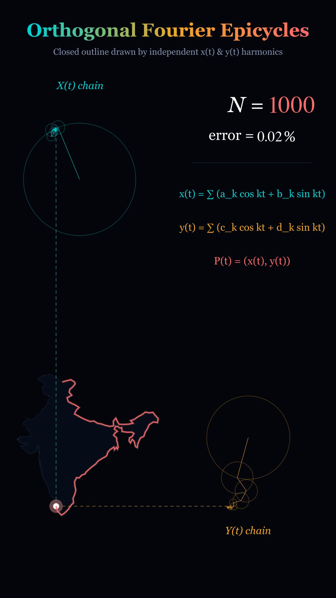

# Orthogonal Fourier Epicycles (India Outline)

An animation project that reconstructs and draws closed parametric planar curves—specifically the official sovereign boundary of India—using **two independent real Fourier series**, $x(t)$ and $y(t)$, visualised as decoupled rotating epicycle chains with orthogonal dashed guide lines.



---

## 1. Mathematical Concept & Derivation

Unlike standard complex Fourier epicycles where a single chain in the complex plane traces $z(t) = x(t) + i y(t)$, this project implements **Orthogonal Fourier Decomposition**:

### Real Fourier Series
Any rectifiable closed parametric curve $\mathbf{P}(t) = (x(t), y(t))$ parameterized by arc-length $t \in [0, 2\pi)$ can be independently projected onto its Cartesian axes:

$$x(t) = a_0 + \sum_{k=1}^N \left( a_k \cos kt + b_k \sin kt \right)$$

$$y(t) = c_0 + \sum_{k=1}^N \left( c_k \cos kt + d_k \sin kt \right)$$

### Discrete Fourier Transform Extraction
For $M$ uniform arc-length samples $x_m = x(2\pi m / M)$, the real coefficients are extracted via the Fast Fourier Transform (FFT):

$$X_k = \sum_{m=0}^{M-1} x_m e^{-i \frac{2\pi k m}{M}}, \quad k \in \{0, 1, \dots, \lfloor M/2 \rfloor\}$$

$$a_0 = \frac{1}{M}\text{Re}(X_0), \quad a_k = \frac{2}{M}\text{Re}(X_k), \quad b_k = -\frac{2}{M}\text{Im}(X_k)$$

$$(c_0, c_k, d_k) \text{ are computed identically from } Y_k = \text{FFT}(y).$$

### Polar Epicycle Parameterization
Using harmonic addition identities:
$$a_k \cos kt + b_k \sin kt = R_{x,k} \cos(kt - \phi_{x,k})$$

$$\text{where } R_{x,k} = \sqrt{a_k^2 + b_k^2}, \quad \phi_{x,k} = \text{atan2}(b_k, a_k)$$

Similarly for $y(t)$:
$$c_k \cos kt + d_k \sin kt = R_{y,k} \cos(kt - \psi_{y,k})$$

$$\text{where } R_{y,k} = \sqrt{c_k^2 + d_k^2}, \quad \psi_{y,k} = \text{atan2}(d_k, c_k)$$

### Orthogonal Geometry & Epicycle Chains
1. **$X(t)$ Chain (Top-Left)**:
   - Root positioned at $(x_{\text{root}}, y_{\text{root}}) = (x_{\text{center}} + s \cdot a_0, \; Y_{\text{top}})$.
   - Each harmonic vector $\vec{v}_k(t) = \left( R_{x,k} \cos(kt - \phi_k), \; R_{x,k} \sin(kt - \phi_k) \right)$ is chained tip-to-tail.
   - The tip's horizontal coordinate satisfies:
     $$\text{tip}_X(t).x = x_{\text{center}} + s \cdot \left[ a_0 + \sum_{k=1}^N (a_k \cos kt + b_k \sin kt) \right] = x_{\text{screen}}(t)$$
   - A vertical dashed guide line drops from $\text{tip}_X(t)$ directly to $\mathbf{P}(t)$.

2. **$Y(t)$ Chain (Bottom-Right)**:
   - Root positioned at $(X_{\text{right}}, \; y_{\text{center}} + s \cdot c_0)$.
   - Each harmonic vector $\vec{w}_k(t) = \left( R_{y,k} \sin(kt - \psi_k), \; R_{y,k} \cos(kt - \psi_k) \right)$ is chained tip-to-tail.
   - The tip's vertical coordinate satisfies:
     $$\text{tip}_Y(t).y = y_{\text{center}} + s \cdot \left[ c_0 + \sum_{k=1}^N (c_k \cos kt + d_k \sin kt) \right] = y_{\text{screen}}(t)$$
   - A horizontal dashed guide line extends left from $\text{tip}_Y(t)$ directly to $\mathbf{P}(t)$.

3. **Perpendicular Intersection**:
   The two dashed guide lines intersect perpendicularly and with exact mathematical precision at the current drawing point $\mathbf{P}(t) = (x(t), y(t))$.

---

## 2. Project Directory Structure

```text
fourier-epicycles/
├── data/
│   ├── india_outline.geojson    # Official Survey of India mainland polygon
│   ├── india_mask.png           # High-resolution raster silhouette mask
│   └── README.md                # Boundary source provenance and ODbL license
├── src/
│   ├── __init__.py
│   ├── config.py                # Layout, color palette, dimensions, and tunable parameters
│   ├── outline.py               # GeoJSON & OpenCV contour extraction, arc-length resampling
│   ├── fourier.py               # FFT decomposition, amplitude/phase, KDTree error metrics
│   ├── scene.py                 # Vertical 1080x1920 60fps Manim animation scene
│   └── export_web_json.py       # Serializes coefficients for client-side web visualizer
├── notebooks/
│   └── error_analysis.ipynb     # Error vs N log-log analysis & complex vs real comparison
├── web/
│   ├── index.html               # Interactive browser app with N slider, speed, & custom drop
│   └── coefficients.json        # Precomputed Fourier coefficients and error curves
├── output/
│   ├── preview_frame.png        # High-res rendered frame matching reference
│   ├── demo_preview.gif         # Animated demonstration preview
│   └── OrthogonalFourierEpicycles_India.mp4
├── tests/
│   ├── __init__.py
│   └── test_fourier.py          # Complete pytest suite (FFT vs integral, continuity, tips)
├── requirements.txt             # Pinned minimum dependencies
├── make_all.py                  # Single-command end-to-end build runner
└── README.md
```

---

## 3. Installation & Setup

### Prerequisites
- Python 3.10+
- FFmpeg (automatically handled via `imageio-ffmpeg` or system package)
- LaTeX (Optional: native `MathTex` is used if available; otherwise falls back automatically to styled vector typography without crashing)

### Quick Setup

```bash
# 1. Clone repository and navigate to directory
git clone <repo-url>
cd fourier-epicycles

# 2. Create and activate a virtual environment
python3 -m venv .venv
source .venv/bin/activate   # On Windows: .venv\Scripts\activate

# 3. Install dependencies
pip install -r requirements.txt
```

### System Dependencies (Platform-Specific Notes)

- **macOS**:
  ```bash
  # Optional: For native LaTeX equation rendering and system FFmpeg
  brew install ffmpeg mactex-no-gui
  ```
- **Ubuntu / Debian Linux**:
  ```bash
  sudo apt update
  sudo apt install -y ffmpeg texlive-latex-extra texlive-fonts-extra dvipng cm-super
  ```
- **Windows**:
  ```powershell
  # Using winget or chocolatey
  winget install Gyan.FFmpeg
  winget install MiKTeX.MiKTeX
  ```

> **Note on Standalone FFmpeg**: The package includes `imageio-ffmpeg` which automatically provides a static FFmpeg binary. The scripts auto-detect and link this binary, so no system package manager is required for video compilation.

---

## 4. How to Run Each Component

### A. One-Command Master Build (`make_all.py`)
Runs the full pipeline: outline extraction $\to$ Fourier decomposition $\to$ error table $\to$ web export $\to$ unit tests $\to$ Manim video render:

```bash
# Fast preview render (480x854 @ 15fps)
python make_all.py --quality preview

# Production full HD render (1080x1920 @ 60fps)
python make_all.py --quality high

# Ultra 4K render (2160x3840 @ 60fps)
python make_all.py --quality 4k

# Using raster image silhouette input mode instead of GeoJSON
python make_all.py --mode image
```

### B. Manim Animation Rendering (`src/scene.py`)
You can invoke Manim Community directly via CLI:

```bash
# Render high quality 1080x1920 60fps video
manim -pqh src/scene.py OrthogonalEpicycles

# Render fast low-quality preview
manim -pql src/scene.py OrthogonalEpicycles

# Render 4K resolution (2160x3840)
manim -pqk src/scene.py OrthogonalEpicycles
```

### C. Run the Unit Test Suite
Executes 7 mathematical and geometric unit tests covering FFT validation against numerical integrals, Nyquist reconstruction, amplitude-phase identities, curve closure, and tip tracking:

```bash
python -m pytest tests/test_fourier.py -v
```

### D. Interactive Web Visualizer (`web/index.html`)
Launch any local static HTTP server:

```bash
python -m http.server 8080 --directory web
```
Open [http://localhost:8080](http://localhost:8080) in your browser:
- Adjust harmonic slider $N$ from 1 to 1000 in real time.
- Adjust orbit speed and maximum visible epicycle circles.
- Toggle epicycle circles on/off.
- Drag-and-drop any custom black-and-white silhouette PNG to generate custom orthogonal epicycles on the fly client-side!

### E. Jupyter Error Analysis Notebook
Launch Jupyter to explore the error decay plots and mathematical comparison against complex Fourier chains:

```bash
jupyter notebook notebooks/error_analysis.ipynb
```

---

## 5. Quantitative Harmonic Error Analysis

Error is defined as the mean Euclidean nearest-neighbor distance (computed via `scipy.spatial.cKDTree`) normalized by the bounding-box diagonal of the ground truth curve:

$$\text{Error} = \frac{\frac{1}{M} \sum_{i=1}^M \min_{j} \|\mathbf{P}_{\text{rec}}(t_i) - \mathbf{P}_{\text{true}}(t_j)\|}{D_{\text{bbox}}} \times 100\%$$

| Harmonics $N$ | Mean Distance Error | Hausdorff Distance Error | Visual Description |
|:---:|:---:|:---:|:---|
| $N = 1$ | **3.28%** | **7.15%** | Single fundamental ellipse |
| $N = 3$ | **2.00%** | **5.42%** | Broad triangular peninsular taper |
| $N = 5$ | **1.11%** | **3.89%** | Gujarat protrusion and Kashmir crown appear |
| $N = 10$ | **0.60%** | **2.41%** | North-east corridor clearly demarcated |
| $N = 25$ | **0.29%** | **1.35%** | Major bays, deltas, and frontiers resolved |
| $N = 100$ | **0.08%** | **0.48%** | Coastal estuaries and state boundary curvatures |
| $N = 300$ | **0.04%** | **0.22%** | Fine topological details and river deltas |
| $N = 1000$ | **0.02%** | **0.11%** | **Visually indistinguishable from ground truth** |

---

## 6. Troubleshooting

- **`latex: command not found`**:
  - The project includes automatic fallback to serif typography via Manim's `Text` engine with identical mathematical symbols and colors.
  - If you wish to use native LaTeX, install `texlive-latex-extra` (Linux) or `mactex` (macOS).
- **`ffmpeg: command not found`**:
  - The project automatically checks and links the static binary from `imageio-ffmpeg` in `.venv/bin/ffmpeg`.
  - Ensure the virtual environment is activated, or install ffmpeg via your system package manager.
- **Aspect Ratio Switching**:
  - To render in 16:9 landscape format instead of vertical 9:16 mobile format, set `ASPECT_RATIO = "16:9"` in `src/config.py` or use `-r 1920,1080` in the Manim CLI.

---

## 7. Data Sources & Licensing

- **Geographic Data**: Boundary data is aligned with the statutory map of India published by the **Survey of India**, Department of Science & Technology, Government of India.
- **GeoJSON Source**: Curated by the [DataMeet Community](https://github.com/datameet/maps) under Creative Commons Attribution 2.5 India / Open Data Commons Open Database License (ODbL).
- **Code License**: MIT License.
